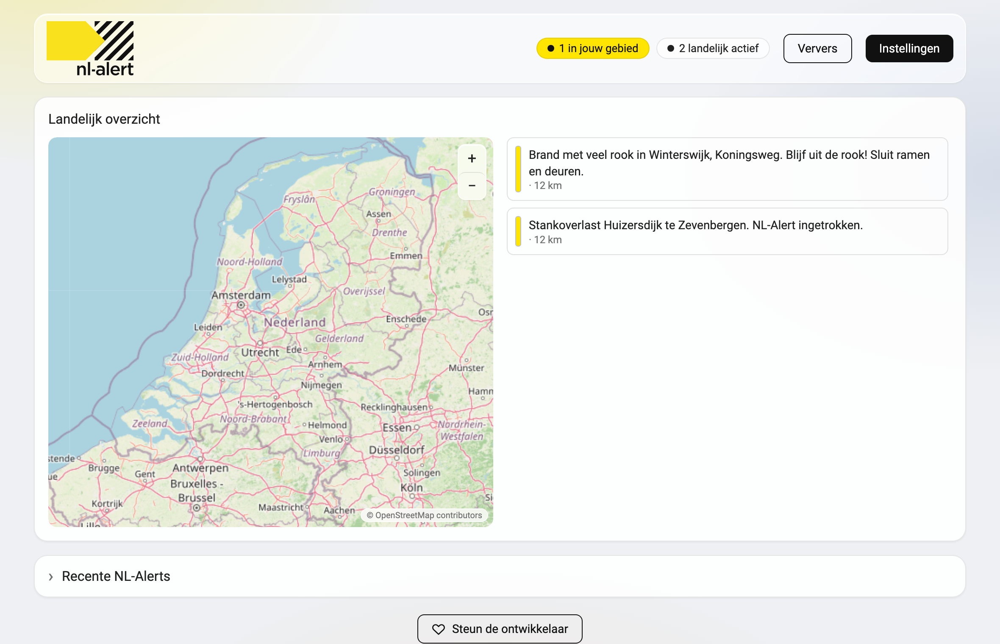
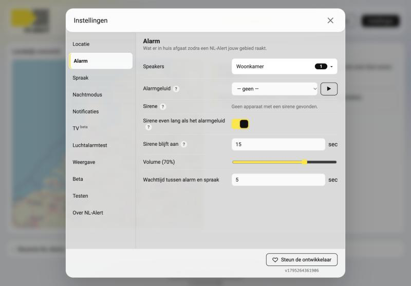
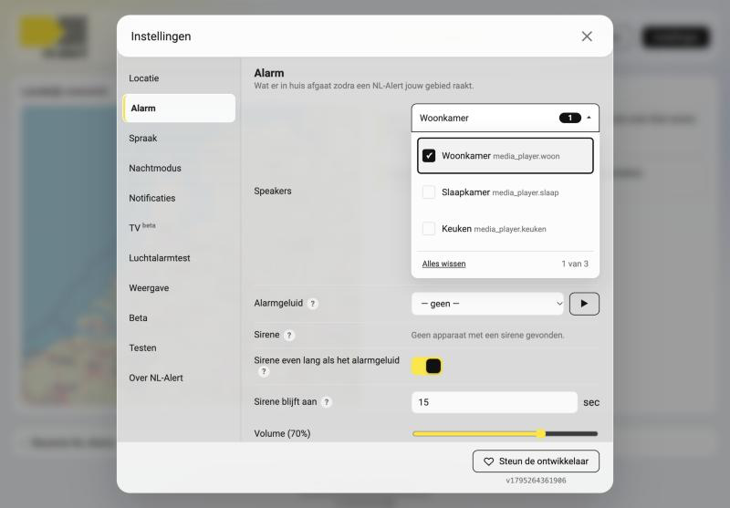

# NL-Alert voor Home Assistant

<p align="center">
  <a href="../../releases/latest"></a>
  <a href="../../actions/workflows/validate.yml"></a>
  <a href="../../actions/workflows/hassfest.yml"></a>
  
  <a href="LICENSE"></a>
</p>

<p align="center">
  <a href="#english"></a>
</p>

<p align="center">
  
</p>

<p align="right">
  <a href="https://my.home-assistant.io/redirect/hacs_repository/?owner=joohann&repository=NL-Alert&category=integration"></a>
</p>

---

Custom integration die actieve NL-Alert waarschuwingen ophaalt en doorgeeft aan je huis: alarm door de speakers, een gesproken aankondiging, een kritieke notificatie op je telefoon en het gewaarschuwde gebied op een kaart.

> Onofficieel. Geen band met de Rijksoverheid of het ministerie van Justitie en Veiligheid. Gegevens komen van de publieke API van [public-warning.app](https://api.public-warning.app). **Vertrouw hier nooit alleen op** — NL-Alert op je telefoon en de sirene blijven leidend.

## Functionaliteit

**Alarmeert gericht**
- Gaat af bij een alert waarvan het gebied jouw locatie dekt, bij een landelijke melding en bij een test. Een incident twee provincies verderop wordt wel getoond en gelogd, maar blijft stil.
- Een instelbare straal in km laat een brand net buiten de grens ook meetellen; de afstand tot de rand van het gebied staat bij elke melding.

**Geluid en spraak**
- Zes eigen alarmtonen, waaronder een slow whoop. Geen verwijzingen naar bestanden van andere integraties.
- Tweetalig: een NL-Alert is Nederlands en meestal Engels na `***`. Beide worden uitgesproken, elk in de eigen taal; ontbreekt het Engels, dan kan het via HA's eigen `ai_task` vertaald worden.
- Koppel een `siren`- of `switch`-entiteit die tegelijk met het alarmgeluid afgaat, ook zonder speakers. Standaard loopt de sirene even lang als het geluid, gelezen uit het bestand zelf.
- Nachtmodus: zachter volume binnen een tijdvenster, eventueel met een ander geluid.

**Notificaties en TV**
- Kritieke notificaties: iOS critical alert en Android alarm-stream. Voor toestellen die de alarm-stream negeren (veel Samsungs) is er per toestel een gesproken variant.
- Cast een Lovelace-view naar een Chromecast, inclusief de TV eerst aanzetten.

**Paneel met kaart**
- Landelijk overzicht, geschiedenis met locatie, slepen, zoomen en dubbelklikken. De kaartlaag is instelbaar: OpenStreetMap, Esri, of je eigen tegel-URL.
- Maandelijkse luchtalarmtest op de eerste maandag om 12:00:00, overgeslagen op feestdagen.
- Eigen brand-icoon via de lokale `brand/` map, geen PR naar de home-assistant/brands-repo nodig.

## Het paneel

<p align="center">
  <picture>
    <source media="(prefers-color-scheme: dark)" srcset="docs/panel-overview-dark.png">
    
  </picture>
</p>

Alles wat nu speelt in één blik: de kaart van Nederland met het gewaarschuwde gebied, en de actieve alerts ernaast met de afstand tot jouw locatie. Onderaan staat de geschiedenis van eerdere meldingen, met een klik om naar de locatie te zoomen.

<p align="center">
  <picture>
    <source media="(prefers-color-scheme: dark)" srcset="docs/panel-settings-dark.png">
    
  </picture>
  &nbsp;
  <picture>
    <source media="(prefers-color-scheme: dark)" srcset="docs/panel-notify-dark.png">
    
  </picture>
</p>

Elke instelling zit in één scherm, verdeeld over een rail: speakers, alarmgeluid, stem, notificaties, nachtmodus, TV en de tests. De keuzelijsten zijn doorzoekbaar en opslaan gaat vanzelf. Klopt er iets niet, dan zegt het paneel precies wát — een verdwenen media player, een ontbrekend geluidsbestand, een TTS-engine die niet gekozen is.

## Installatie

**Marketplace** (Home Assistant 2026.11 en nieuwer, waar HACS onderdeel van de core werd)

De **Add to Marketplace**-knop hierboven voegt de repository in één stap toe; installeer daarna **NL-Alert** en herstart Home Assistant. Of met de hand:

1. Open de **Marketplace** en klik rechtsboven op **Add from link**.
2. Plak `https://github.com/joohann/NL-Alert`, categorie **Integration**.
3. Installeer **NL-Alert** en herstart Home Assistant.

Op oudere versies met HACS los geïnstalleerd lopen dezelfde stappen via HACS, drie stipjes, **Custom repositories**.

**Handmatig**

Kopieer de map `custom_components/nl_alert` naar je `config/custom_components/` en herstart Home Assistant.

Daarna in beide gevallen: ga naar **Instellingen → Apparaten & diensten → Integratie toevoegen** en zoek naar "NL-Alert".

## Instellen

Bij het toevoegen vraagt de integratie alleen om je locatie en het ophaalinterval. Al het andere staat in het **NL-Alert paneel** in de zijbalk.

De **maandelijkse luchtalarmtest** vereist de **Holiday**-integratie van Home Assistant (land: Nederland). Zonder feestdagenkalender wordt de test elke maand overgeslagen in plaats van geraden — een sirene op Koningsdag is erger dan een gemiste test. Home Assistant meldt dit zelf via Reparaties.

## Entiteiten

| Entiteit | Beschrijving |
| --- | --- |
| `binary_sensor.nl_alert_alert_in_gebied` | Aan zodra een alert jouw gebied dekt |
| `sensor.nl_alert_actieve_alerts_nl` | Aantal actieve alerts in Nederland |
| `sensor.nl_alert_actieve_alerts_in_gebied` | Aantal in jouw gebied |
| `sensor.nl_alert_laatste_actieve_alert_nl` | Tekst van de laatste landelijke alert |
| `sensor.nl_alert_laatste_alert_in_gebied` | Tekst van de laatste alert bij jou |
| `button.nl_alert_test_*` | Vier testknoppen |

Er is ook een service `nl_alert.test_alert` en een Lovelace-kaart `custom:nl-alert-card`.

## Beperkingen / aandachtspunten

- **Het paneel is alleen Nederlands.** De config flow is NL en EN; de paneelteksten nog niet.
- **Casten vereist HTTPS.** HA Cast werkt alleen als je instantie via HTTPS bereikbaar is (Nabu Casa Cloud of een eigen certificaat).
- **Kritieke notificaties zijn een verzoek, geen garantie.** Op iOS alleen met Apple's critical-alert-recht; op Android hangt het van het toestel af.
- **Kaartlagen veranderen.** CARTO zet sinds augustus 2026 "API KEY REQUIRED" in elke tegel. Standaard is nu OpenStreetMap; Esri staat als alternatief klaar en je kunt elke andere tegel-URL invullen.
- **Exacte timing.** De maandelijkse test vuurt op de seconde, maar tussen het commando en geluid uit een cloud-gekoppelde speaker zit latentie.

## Ontwikkelen

De pure logica — URL-opbouw, berichtsplitsing, geometrie, tijdvensters, notificatie-payloads en de kalenderberekening — heeft offline checks die geen draaiende Home Assistant nodig hebben:

```bash
python3 custom_components/nl_alert/tests/offline_checks.py
```

## Licentie

MIT — zie [LICENSE](LICENSE).

---

# English

<p align="center">
  <a href="#nl-alert-voor-home-assistant"></a>
</p>

A Home Assistant custom integration that fetches active NL-Alert warnings and passes them to your home: an alarm over the speakers, a spoken announcement, a critical notification on your phone, and the warned area on a map. NL-Alert is the Dutch national public warning system.

> Unofficial. Not affiliated with or endorsed by the Dutch government. Data comes from the public API at [public-warning.app](https://api.public-warning.app). **Never rely on this alone** — NL-Alert on your phone and the sirens remain authoritative.

## Features

**Alarms on what concerns you**
- Fires for an alert whose area covers your location, for a national message, and for a test. An incident two provinces away is shown and logged, but stays silent.
- An adjustable radius in km lets a fire just outside the boundary count too; the distance to the edge of the area is shown with every message.

**Sound and speech**
- Six built-in alarm tones, including a slow whoop. No references to files from other integrations.
- Bilingual: an NL-Alert is Dutch, and usually English after `***`. Both are spoken, each in its own language; if the English is missing it can be translated through HA's own `ai_task`.
- Attach a `siren` or `switch` entity that sounds alongside the alarm tone, even with no speakers. By default the siren runs exactly as long as the sound, read from the file itself.
- Night mode: a softer volume within a time window, optionally with a different sound.

**Notifications and TV**
- Critical notifications: iOS critical alert and the Android alarm stream. For devices that ignore the alarm stream (many Samsungs) there is a per-device spoken variant.
- Cast a Lovelace view to a Chromecast, waking the TV first.

**Panel with a map**
- National overview, history with location, drag, zoom and double-click. The map layer is configurable: OpenStreetMap, Esri, or your own tile URL.
- Monthly siren test on the first Monday at 12:00:00, skipped on public holidays.
- Its own brand icon through the local `brand/` folder, no PR to home-assistant/brands needed.

## The panel

<p align="center">
  <picture>
    <source media="(prefers-color-scheme: dark)" srcset="docs/panel-overview-dark.png">
    
  </picture>
</p>

Everything going on right now at a glance: the map of the Netherlands with the warned area, and the active alerts beside it with the distance to your location. Below sits the history of earlier messages, each with a click to zoom to its location.

<p align="center">
  <picture>
    <source media="(prefers-color-scheme: dark)" srcset="docs/panel-settings-dark.png">
    
  </picture>
  &nbsp;
  <picture>
    <source media="(prefers-color-scheme: dark)" srcset="docs/panel-notify-dark.png">
    
  </picture>
</p>

Every setting lives in one screen, split over a rail: speakers, alarm sound, voice, notifications, night mode, TV and the tests. The pickers are searchable and saving happens on its own. If something is wrong, the panel says exactly what — a media player that is gone, a missing sound file, a TTS engine that was not picked.

## Installation

**Marketplace** (Home Assistant 2026.11 and later, where HACS became part of core)

The **Add to Marketplace** button above adds the repository in one step; then install **NL-Alert** and restart Home Assistant. Or by hand:

1. Open the **Marketplace** and click **Add from link** in the top right.
2. Paste `https://github.com/joohann/NL-Alert`, category **Integration**.
3. Install **NL-Alert**, then restart Home Assistant.

On older versions with HACS installed separately, the same steps live under HACS, three dots, **Custom repositories**.

**Manual**

Copy the `custom_components/nl_alert` folder into your `config/custom_components/` directory and restart Home Assistant.

Then in both cases: go to **Settings → Devices & services → Add integration** and search for "NL-Alert".

## Setup

When you add it, the integration only asks for your location and the check interval. Everything else lives in the **NL-Alert panel** in the sidebar.

The **monthly siren test** needs Home Assistant's **Holiday** integration (country: Netherlands). Without a holiday calendar the test is skipped each month rather than guessed — a siren on a national holiday is worse than a missed test. Home Assistant flags this itself under Repairs.

## Entities

| Entity | What it holds |
| --- | --- |
| `binary_sensor.nl_alert_alert_in_gebied` | On as soon as an alert covers your area |
| `sensor.nl_alert_actieve_alerts_nl` | Number of active alerts in the Netherlands |
| `sensor.nl_alert_actieve_alerts_in_gebied` | Number in your area |
| `sensor.nl_alert_laatste_actieve_alert_nl` | Text of the latest national alert |
| `sensor.nl_alert_laatste_alert_in_gebied` | Text of the latest alert near you |
| `button.nl_alert_test_*` | Four test buttons |

There is also a `nl_alert.test_alert` service and a Lovelace card `custom:nl-alert-card`.

## Notes

- **The panel is Dutch only.** The config flow is NL and EN; the panel text is not yet.
- **Casting requires HTTPS.** HA Cast only works when your instance is reachable over HTTPS (Nabu Casa Cloud or your own certificate).
- **Critical notifications are a request, not a guarantee.** On iOS only with Apple's critical-alert entitlement; on Android it depends on the device.
- **Map layers change.** Since August 2026 CARTO stamps "API KEY REQUIRED" on every tile. The default is now OpenStreetMap; Esri is ready as an alternative and you can fill in any other tile URL.
- **Exact timing.** The monthly test fires on the second, but there is latency between the command and sound from a cloud-connected speaker.

## Development

The pure logic — URL building, message splitting, geometry, time windows, notification payloads and the calendar calculation — has offline checks that need no running Home Assistant:

```bash
python3 custom_components/nl_alert/tests/offline_checks.py
```

## License

MIT — see [LICENSE](LICENSE).
